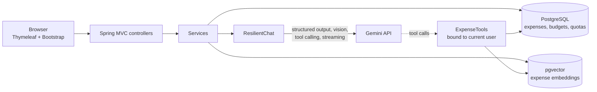

# SpendWitz: AI expense tracker

Built for how people in India actually pay: bills, UPI and cash. Say *"sabzi 150, chai 20, kal auto 60"* (or type it, in English, Hindi or Hinglish) and it becomes three expenses. Snap a bill or a UPI screenshot and the details fill themselves in. Ask *"How much cash did I spend this month?"* and get an exact answer computed from your own data.

**Live demo:** https://YOUR-APP.onrender.com (click **Enter demo account**, no sign-up needed)

> The demo runs on free tiers. The first request after a period of inactivity can take up to a minute while the server wakes up.

    

## Features

| Feature | How it works |
|---|---|
| **Type it or say it** | For purchases with no bill (kirana, sabzi, autos). Free text or voice (the browser's Web Speech API, English or Hindi) is split by Gemini into separate expenses, with relative dates ("kal" = yesterday) and payment methods ("gpay" = UPI) resolved. You review them in an editable table before saving. |
| **Bill & UPI screenshot scanning** | Upload a bill photo, PDF, or a UPI payment screenshot. Gemini's vision model returns structured JSON (merchant/payee, date, items, tax, total, UPI reference). Failed payments and money *received* are rejected. You review before anything is saved. |
| **Bank statement import** | Upload a bank or credit card statement (PDF, including password-protected ones, Excel or CSV). For spreadsheets the model only identifies the columns, and every date and amount is parsed in Java, straight from the cells. For PDFs the model extracts rows and each amount is checked against the PDF text. The model then cleans up narrations (`UPI/DR/6299…/GUPTA GENERAL/okaxis` → "Gupta General Store") and leaves out non-spending (own-account transfers, card bill payments, investments). ATM withdrawals go to the cash wallet, and transactions already in SpendWitz are flagged (same UPI reference, or same amount within a day) before you review and save. A sample statement from a fictional bank is generated on the fly for the demo. |
| **Cash section** | One-tap entry for everyday cash spends (chai, sabzi, auto, milk, kirana) with no AI needed, plus a cash wallet: record ATM withdrawals and see *cash in hand*. |
| **Payment methods** | Every expense records UPI / Cash / Card / Net banking. The dashboard shows how you paid, and the assistant can answer cash-only questions. |
| **AI assistant (agent)** | Ask questions in plain English. The model calls read-only Java tools (`getTotalSpending`, `getTopMerchants`, `getBudgetStatus`, ...) and streams back a Markdown answer. |
| **Learns your categories** | When you correct a category, it sticks. Category suggestions check your history first (same merchant, then the nearest embedding in pgvector) and only fall back to the model's guess. |
| **Smart search** | Search by meaning: "coffee near the office" or "vacation" finds the right expenses even without matching words. |
| **AI insights** | A monthly summary written by the model from facts computed in SQL. |
| **Budgets & dashboard** | Monthly limits per category, progress bars, category and trend charts. |

## Architecture



## Engineering decisions worth discussing

- **The LLM never touches the database directly.** The assistant can only call a fixed set of read-only, parameterised Java methods. A new `ExpenseTools` instance is created for each request, bound to the logged-in user's id, so the model can't see or choose another user's id. There is no model-written SQL, which closes off SQL injection and cross-user data leaks through prompt injection.
- **The LLM doesn't do arithmetic.** An early version let the model add up rows itself, and it was off by ₹100 on a real query. Now every total and count comes from SQL (`ExpenseStats` aggregates any filter), and the system prompt forbids summing. Monthly insights work the same way: SQL computes the facts and the model only writes the sentences.
- **Designed for Indian spending habits.** Most small purchases come without a bill, so bills are just one of four ways in (text, voice, bill/UPI scan, one-tap cash). Voice uses the browser's free speech recognition; only the transcript goes to the LLM.
- **The LLM never decides money amounts when the file already has them.** For statement spreadsheets the model only maps columns; amounts and dates are parsed in Java. For PDFs every model-extracted amount is checked against the page text, and unconfirmed ones are flagged for the user.
- **Structured output with defensive parsing.** Receipt data is parsed into a Java record. Dates and categories come back as strings and are validated in Java, so a slightly-off model answer degrades gracefully instead of failing the scan.
- **Free-tier protection.** Every AI call goes through `AiQuotaService`, which enforces per-user and app-wide daily caps. The counters are stored in Postgres with an atomic `INSERT ... ON CONFLICT ... RETURNING`, so they survive restarts and work across instances.
- **Graceful degradation.** If Gemini returns 503 (overloaded) or 429 (rate-limited), `ResilientChat` retries once on a lighter model. Streaming only falls back if no text has been sent yet.
- **Embeddings are kept off the critical path.** Saving an expense publishes an event; indexing runs `@Async` after the transaction commits (`@TransactionalEventListener`). A slow or failing embedding call never blocks or rolls back a save. Bulk indexing paces itself to stay under the free-tier per-minute limit.
- **Hybrid category learning.** A deterministic database lookup (same merchant) runs before vector similarity, which runs before the LLM. This is cheap, predictable and explainable: the UI tells you *why* a category was chosen.
- **Streaming over NDJSON.** The assistant streams `Flux<ChatChunk>` from Spring MVC as `application/x-ndjson`; the browser reads it with `fetch` and renders Markdown, sanitised with DOMPurify.

## Tech stack

Java 21 · Spring Boot 4 · Spring AI 2 (Google GenAI) · Apache POI · PDFBox · Spring Security · Spring Data JPA / Hibernate · PostgreSQL + pgvector · Flyway · Thymeleaf · Bootstrap 5 · Chart.js · JUnit 5 + Testcontainers · Docker · GitHub Actions

## Run locally

Prerequisites: JDK 21, Docker Desktop, and a free Gemini API key from https://aistudio.google.com/apikey

```bash
cp .env.example .env          # then put your GEMINI_API_KEY in .env
./mvnw spring-boot:run        # starts Postgres+pgvector via compose.yaml automatically
```

Open http://localhost:8080 and click **Enter demo account** (demo@spendwitz.app / demo1234).

Run the tests (they start their own pgvector container and never call Gemini):

```bash
./mvnw verify
```

## Deploy for free (Render + Neon)

1. **Database:** create a free project on [Neon](https://neon.tech). Neon supports pgvector, and the Flyway migration enables it. In **Connect**, turn **Connection pooling off** (use the direct connection: Flyway and the pgvector session settings need it), then copy the host, database, user and password.
2. **App:** push this repo to GitHub. On [Render](https://render.com), choose **New > Blueprint** and select the repo; `render.yaml` creates a free Docker web service.
3. Set the environment variables in Render:

   | Variable | Example |
   |---|---|
   | `GEMINI_API_KEY` | your key |
   | `DATABASE_URL` | `jdbc:postgresql://ep-xxx.aws.neon.tech/neondb?sslmode=require` |
   | `DATABASE_USERNAME` | `neondb_owner` |
   | `DATABASE_PASSWORD` | your password |
   | `GEMINI_CHAT_MODEL` | `gemini-3.5-flash-lite` (preset by `render.yaml`) |
   | `GEMINI_FALLBACK_MODEL` | `gemini-3.1-flash-lite` (preset; separate free quota, used on 429/503) |

4. *(Optional)* Render's free tier sleeps after 15 minutes without traffic. A free [UptimeRobot](https://uptimerobot.com) monitor on `/actuator/health/liveness` every 5 minutes keeps it awake. That endpoint doesn't touch the database, so Neon can still scale to zero.

The demo account is created on first start and reset every night at 03:00 IST.

## Project structure

```
src/main/java/com/spendwitz
├── ai/          AiQuotaService, ExpenseIndexer (pgvector), CategorySuggester, ResilientChat
├── assistant/   ExpenseTools (LLM tools), AssistantService (streaming agent), controller
├── receipt/     ReceiptScanService (bills + UPI screenshots: vision + structured output)
├── quickadd/    QuickAddService (text / voice, Hinglish → expenses), review-and-save flow
├── cash/        Cash wallet (ATM withdrawals, cash in hand) and one-tap cash entry
├── statement/   Bank statement import: PDF/Excel/CSV reading (PDFBox, Apache POI), column mapping, duplicate detection
├── dashboard/   DashboardService, InsightService (AI insights), controller
├── expense/     Expense entity, repository, specs, stats, CRUD
├── budget/      Budgets and budget status
├── demo/        Demo account seeding and nightly reset
├── user/        Registration and Spring Security user details
├── config/      Security, AI, clock, typed properties
└── web/         Smart search, home, global model attributes
```

## Possible next steps

- Recurring-expense detection ("Netflix renews in 3 days")
- Multi-currency with exchange rates
- An MCP server exposing the same tools to other AI clients
- Asymmetric embeddings (`RETRIEVAL_DOCUMENT` for expenses, `RETRIEVAL_QUERY` for searches) to improve short, vague queries like "vacation"
